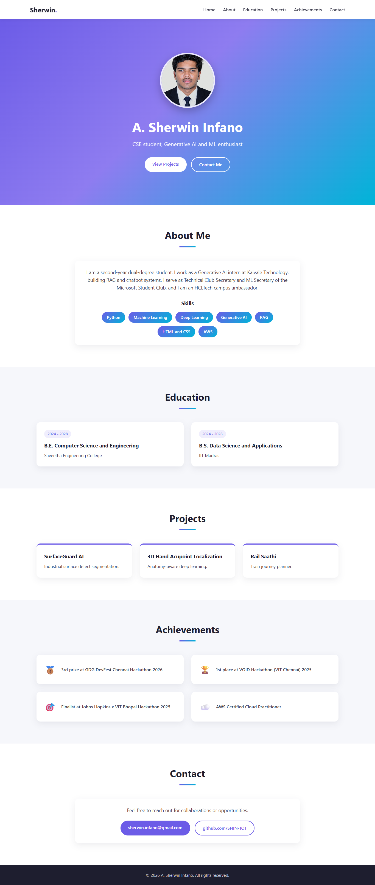

# Ex01 Portfolio
## Date: 24-10-2026

## AIM
To create a Portfolio using HTML and CSS.

## ALGORITHM
### STEP 1
Create an HTML file (index.html)

### STEP 2
Create a CSS file (style.css)

### STEP 3
Include a navigation bar with links to different sections.

### STEP 4
Add structured sections for introduction, about, projects, and contact details.

### STEP 5
Define global styles for fonts, colors, and layout.

### STEP 6
Style the header, navigation bar, and sections.

### STEP 7
Use Flexbox or CSS Grid for layout design.

### STEP 8
Add hover effects and transitions for interactivity.

### STEP 9
Add Images and Media.

### STEP 10
Use optimized images for a professional look.

### STEP 11
Open the HTML file in a browser to check layout and functionality.

### STEP 12
Fix styling issues and refine content placement.

### STEP 13
Deploy the Portfolio.

### STEP 14
Upload to GitHub Pages for free hosting.

## PROGRAM

### index.html
```html
<!DOCTYPE html>
<html lang="en">
<head>
  <meta charset="UTF-8">
  <meta name="viewport" content="width=device-width, initial-scale=1.0">
  <title>A. Sherwin Infano | Portfolio</title>
  <link rel="icon" href="data:,">
  <link rel="stylesheet" href="style.css">
</head>
<body>
  <nav class="navbar">
    <a href="#home" class="logo">Sherwin<span>.</span></a>
    <ul class="nav-links">
      <li><a href="#home">Home</a></li>
      <li><a href="#about">About</a></li>
      <li><a href="#education">Education</a></li>
      <li><a href="#projects">Projects</a></li>
      <li><a href="#achievements">Achievements</a></li>
      <li><a href="#contact">Contact</a></li>
    </ul>
  </nav>

  <header id="home" class="hero">
    <div class="hero-content">
      
      <h1>A. Sherwin Infano</h1>
      <p class="tagline">CSE student, Generative AI and ML enthusiast</p>
      <div class="hero-buttons">
        <a href="#projects" class="btn btn-primary">View Projects</a>
        <a href="#contact" class="btn btn-outline">Contact Me</a>
      </div>
    </div>
  </header>

  <main>
    <section id="about" class="section">
      <h2 class="section-title">About Me</h2>
      <div class="about-card card">
        <p>
          I am a second-year dual-degree student. I work as a Generative AI intern at
          Kaivale Technology, building RAG and chatbot systems. I serve as Technical Club
          Secretary and ML Secretary of the Microsoft Student Club, and I am an HCLTech
          campus ambassador.
        </p>
        <h3>Skills</h3>
        <ul class="skills">
          <li>Python</li>
          <li>Machine Learning</li>
          <li>Deep Learning</li>
          <li>Generative AI</li>
          <li>RAG</li>
          <li>HTML and CSS</li>
          <li>AWS</li>
        </ul>
      </div>
    </section>

    <section id="education" class="section alt">
      <h2 class="section-title">Education</h2>
      <div class="grid two">
        <div class="card">
          <span class="badge">2024 - 2028</span>
          <h3>B.E. Computer Science and Engineering</h3>
          <p>Saveetha Engineering College</p>
        </div>
        <div class="card">
          <span class="badge">2024 - 2028</span>
          <h3>B.S. Data Science and Applications</h3>
          <p>IIT Madras</p>
        </div>
      </div>
    </section>

    <section id="projects" class="section">
      <h2 class="section-title">Projects</h2>
      <div class="grid three">
        <div class="card project">
          <h3>SurfaceGuard AI</h3>
          <p>Industrial surface defect segmentation.</p>
        </div>
        <div class="card project">
          <h3>3D Hand Acupoint Localization</h3>
          <p>Anatomy-aware deep learning.</p>
        </div>
        <div class="card project">
          <h3>Rail Saathi</h3>
          <p>Train journey planner.</p>
        </div>
      </div>
    </section>

    <section id="achievements" class="section alt">
      <h2 class="section-title">Achievements</h2>
      <div class="grid two">
        <div class="card achievement">
          <span class="icon">🥉</span>
          <p>3rd prize at GDG DevFest Chennai Hackathon 2026</p>
        </div>
        <div class="card achievement">
          <span class="icon">🏆</span>
          <p>1st place at VOID Hackathon (VIT Chennai) 2025</p>
        </div>
        <div class="card achievement">
          <span class="icon">🎯</span>
          <p>Finalist at Johns Hopkins x VIT Bhopal Hackathon 2025</p>
        </div>
        <div class="card achievement">
          <span class="icon">☁️</span>
          <p>AWS Certified Cloud Practitioner</p>
        </div>
      </div>
    </section>

    <section id="contact" class="section">
      <h2 class="section-title">Contact</h2>
      <div class="contact-card card">
        <p>Feel free to reach out for collaborations or opportunities.</p>
        <div class="contact-links">
          <a href="mailto:sherwin.infano@gmail.com" class="btn btn-primary">sherwin.infano@gmail.com</a>
          <a href="https://github.com/SHIN-1O1" target="_blank" rel="noopener" class="btn btn-outline-dark">github.com/SHIN-1O1</a>
        </div>
      </div>
    </section>
  </main>

  <footer class="footer">
    <p>&copy; 2026 A. Sherwin Infano. All rights reserved.</p>
  </footer>
</body>
</html>
```

### style.css
```css
:root {
  --primary: #6c5ce7;
  --secondary: #00b4d8;
  --dark: #1e1e2f;
  --text: #3d3d4e;
  --light: #f6f7fb;
  --white: #ffffff;
  --radius: 14px;
  --shadow: 0 8px 24px rgba(30, 30, 47, 0.08);
}

* {
  margin: 0;
  padding: 0;
  box-sizing: border-box;
}

html {
  scroll-behavior: smooth;
  scroll-padding-top: 70px;
}

body {
  font-family: "Segoe UI", Roboto, Helvetica, Arial, sans-serif;
  color: var(--text);
  background: var(--white);
  line-height: 1.6;
}

a {
  text-decoration: none;
}

/* Navbar */
.navbar {
  position: sticky;
  top: 0;
  z-index: 100;
  display: flex;
  justify-content: space-between;
  align-items: center;
  padding: 16px 8%;
  background: rgba(255, 255, 255, 0.95);
  backdrop-filter: blur(8px);
  box-shadow: 0 2px 12px rgba(0, 0, 0, 0.06);
}

.logo {
  font-size: 1.5rem;
  font-weight: 700;
  color: var(--dark);
}

.logo span {
  color: var(--primary);
}

.nav-links {
  display: flex;
  gap: 28px;
  list-style: none;
}

.nav-links a {
  color: var(--text);
  font-weight: 500;
  transition: color 0.2s;
}

.nav-links a:hover {
  color: var(--primary);
}

/* Hero */
.hero {
  min-height: 88vh;
  display: flex;
  align-items: center;
  justify-content: center;
  text-align: center;
  padding: 80px 20px;
  background: linear-gradient(135deg, var(--primary) 0%, #8e7cf0 45%, var(--secondary) 100%);
  color: var(--white);
}

.profile-pic {
  width: 200px;
  height: 200px;
  border-radius: 50%;
  object-fit: cover;
  border: 5px solid rgba(255, 255, 255, 0.85);
  box-shadow: 0 12px 32px rgba(0, 0, 0, 0.25);
  margin-bottom: 24px;
}

.hero h1 {
  font-size: 3rem;
  margin-bottom: 8px;
}

.tagline {
  font-size: 1.25rem;
  opacity: 0.92;
  margin-bottom: 32px;
}

.hero-buttons {
  display: flex;
  gap: 16px;
  justify-content: center;
  flex-wrap: wrap;
}

/* Buttons */
.btn {
  display: inline-block;
  padding: 12px 28px;
  border-radius: 50px;
  font-weight: 600;
  transition: transform 0.2s, box-shadow 0.2s, background 0.2s, color 0.2s;
}

.btn:hover {
  transform: translateY(-3px);
  box-shadow: 0 8px 20px rgba(0, 0, 0, 0.18);
}

.btn-primary {
  background: var(--white);
  color: var(--primary);
}

.contact-card .btn-primary {
  background: var(--primary);
  color: var(--white);
}

.btn-outline {
  border: 2px solid var(--white);
  color: var(--white);
}

.btn-outline:hover {
  background: var(--white);
  color: var(--primary);
}

.btn-outline-dark {
  border: 2px solid var(--primary);
  color: var(--primary);
}

.btn-outline-dark:hover {
  background: var(--primary);
  color: var(--white);
}

/* Sections */
.section {
  padding: 80px 8%;
}

.section.alt {
  background: var(--light);
}

.section-title {
  text-align: center;
  font-size: 2.2rem;
  color: var(--dark);
  margin-bottom: 48px;
  position: relative;
}

.section-title::after {
  content: "";
  display: block;
  width: 60px;
  height: 4px;
  margin: 12px auto 0;
  border-radius: 2px;
  background: linear-gradient(90deg, var(--primary), var(--secondary));
}

/* Cards */
.card {
  background: var(--white);
  border-radius: var(--radius);
  padding: 28px;
  box-shadow: var(--shadow);
  transition: transform 0.25s, box-shadow 0.25s;
}

.card:hover {
  transform: translateY(-6px);
  box-shadow: 0 16px 36px rgba(108, 92, 231, 0.18);
}

.card h3 {
  color: var(--dark);
  margin-bottom: 8px;
}

.grid {
  display: grid;
  gap: 28px;
  max-width: 1100px;
  margin: 0 auto;
}

.grid.two {
  grid-template-columns: repeat(2, 1fr);
}

.grid.three {
  grid-template-columns: repeat(3, 1fr);
}

.about-card,
.contact-card {
  max-width: 820px;
  margin: 0 auto;
  text-align: center;
}

.about-card p {
  font-size: 1.1rem;
  margin-bottom: 28px;
}

.badge {
  display: inline-block;
  font-size: 0.85rem;
  font-weight: 600;
  color: var(--primary);
  background: rgba(108, 92, 231, 0.1);
  padding: 4px 12px;
  border-radius: 50px;
  margin-bottom: 12px;
}

.project {
  border-top: 4px solid var(--primary);
}

.achievement {
  display: flex;
  align-items: center;
  gap: 18px;
}

.achievement .icon {
  font-size: 2rem;
}

.achievement p {
  font-weight: 500;
}

/* Skill chips */
.skills {
  display: flex;
  flex-wrap: wrap;
  justify-content: center;
  gap: 12px;
  list-style: none;
  margin-top: 16px;
}

.skills li {
  padding: 8px 18px;
  border-radius: 50px;
  background: linear-gradient(135deg, var(--primary), var(--secondary));
  color: var(--white);
  font-weight: 500;
  font-size: 0.95rem;
  transition: transform 0.2s;
}

.skills li:hover {
  transform: scale(1.08);
}

/* Contact */
.contact-card p {
  margin-bottom: 24px;
  font-size: 1.1rem;
}

.contact-links {
  display: flex;
  gap: 16px;
  justify-content: center;
  flex-wrap: wrap;
}

/* Footer */
.footer {
  background: var(--dark);
  color: #c9c9d6;
  text-align: center;
  padding: 24px;
  font-size: 0.95rem;
}

/* Mobile */
@media (max-width: 800px) {
  .navbar {
    flex-direction: column;
    gap: 10px;
    padding: 12px 5%;
  }

  .nav-links {
    flex-wrap: wrap;
    justify-content: center;
    gap: 14px;
  }

  .hero h1 {
    font-size: 2.2rem;
  }

  .profile-pic {
    width: 160px;
    height: 160px;
  }

  .section {
    padding: 60px 6%;
  }

  .grid.two,
  .grid.three {
    grid-template-columns: 1fr;
  }
}
```

## OUTPUT


## RESULT
The program for creating Portfolio using HTML and CSS is executed successfully.
